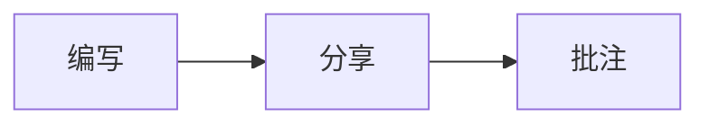
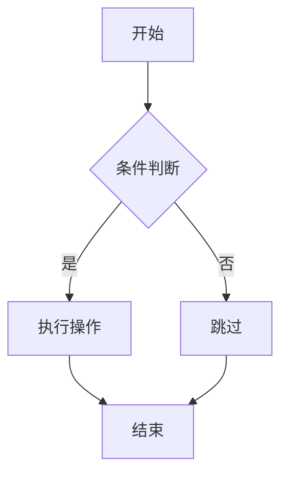

# MD批注协作平台（匿名版 · 一期）

前后端分离：FastAPI + SQLite + Vue3 + Element Plus。支持 Markdown 编写、分享三档权限、预览批注高亮、版本快照、Mermaid 流程图。

## 目录

```
md-annotate/
  backend/          # FastAPI，端口 8000
  frontend/         # Vite + Vue3，端口 5173
  README.md
```

## 启动

### 后端

```bash
cd backend
python3 -m venv .venv
source .venv/bin/activate
pip install -r requirements.txt
uvicorn app.main:app --host 0.0.0.0 --port 8000 --reload
```

数据库文件：`backend/app.db`（首次启动自动建表）

### 前端

```bash
cd frontend
npm install
npm run dev
```

浏览器打开：http://127.0.0.1:5173  
API 健康检查：http://127.0.0.1:8000/api/health

Vite 已代理 `/api` 与 `/ws` 到后端。

## 验证 Mermaid

新建文档默认正文已含示例如下；也可自行写入：

````md


### 自上而下（TD）


````

右侧预览应渲染出流程图。

## 权限说明

- 创建人：浏览器 `localStorage` 保存 `owner_secret`，请求头 `X-Owner-Secret`
- 分享：`read` / `comment` / `edit`
- 批注归属：浏览器 `client_key`（`X-Client-Key`），仅能改删自己的批注；创建人可管理全部

## 一期范围外

登录账号、分享过期、图片上传、PDF 导出、正文实时协同、多层批注嵌套。
